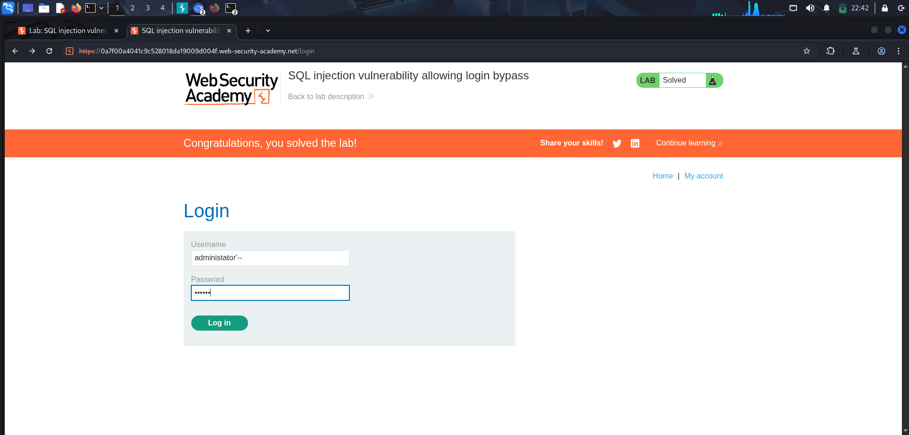
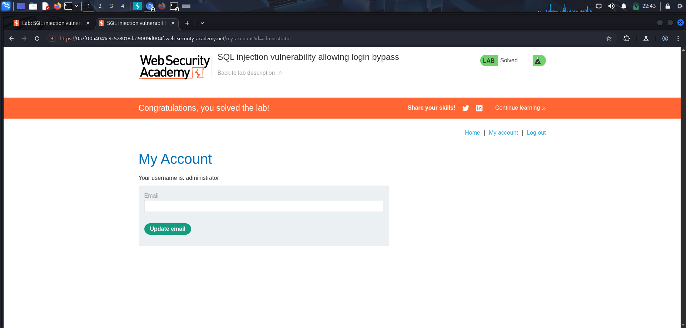

SQL Injection: Login Bypass

Platform: PortSwigger Web Security Academy
Category: Web Exploitation
Vulnerability: SQL Injection (SQLi) — Authentication Bypass
Tool: Burp Suite (embedded browser)
Difficulty: Apprentice
Status: Successfully completed

1. Objective

The objective of this lab was to exploit a SQL injection vulnerability in the login form to authenticate as the administrator user without knowledge of the correct password.

2. Initial Reconnaissance

I opened the lab in Burp Suite's embedded browser and navigated to the login page. The form accepted two inputs, a username and a password, and submitted them to the application for verification.

Since the previous lab had shown that application inputs were not always sanitised before being used in database queries, I treated the username field as a point worth testing directly.

3. Testing the Input

I entered the following in the username field:

administrator'--

and an arbitrary value in the password field, since I expected the password check to be bypassed if the injection succeeded.

Submitting the form logged me in as the administrator account, with no valid password required.

4. Why the Payload Worked

A login form typically verifies credentials with a query resembling:

SELECT * FROM users
WHERE username = 'administrator' AND password = 'x';

This is an illustrative example, not a confirmed copy of the application's actual query.

The single quote in the payload closed the string literal early, so the remainder of the input was interpreted as part of the SQL statement rather than as plain text. The -- sequence then acted as a SQL comment marker in the context of this lab, commenting out everything that followed it, including the AND password = '...' condition.

As a result, the query was reduced to checking the username alone. Since a user named administrator existed, the application treated the login as valid and granted access to that account without ever evaluating the password.

5. Results and Evidence

Before the successful test, the login form behaved as expected and required a valid username and password. After submitting the payload, the application granted access to the administrator account and redirected to its "My account" page. PortSwigger then displayed its lab-completion confirmation.

Figure 1. Login form with the injection payload submitted in the username field.

Figure 2. Authenticated as administrator, with lab marked as solved.

6. Challenges and Troubleshooting

The main point to get right was payload ordering from the previous lab: the comment marker -- must be placed after any additional logic, as anything following it is discarded. In this case the payload was simpler, a single closed quote followed immediately by the comment marker, since the goal was to remove the password check entirely rather than add an alternate condition.

7. Key Learnings

• Login forms that build SQL queries from unsanitised input can be bypassed entirely, not just manipulated.
• A single closed quote followed by a comment marker can remove an entire condition from a WHERE clause.
• Authentication logic should never rely on string-built SQL, since the integrity of the entire check depends on correctly escaped input.
• The same underlying flaw (unsanitised input reaching a SQL query) can be exploited differently depending on where it appears in an application, whether in a filter parameter or in a login form.

8. Remediation

Developers should use parameterized queries (prepared statements) so user input is always treated as data and never as part of the executable SQL statement. Authentication checks are especially sensitive, since a successful bypass grants direct account access rather than just exposing extra data.

Parameterized queries are the primary defence here. Additional layers should include least-privilege database accounts, input validation, and monitoring or rate-limiting on login attempts to catch exploitation attempts.

9. Conclusion

I successfully completed a SQL injection lab demonstrating authentication bypass. By closing the username string and commenting out the password check, I was able to log in as the administrator account without valid credentials.

This lab reinforced that SQL injection is not limited to data exposure; when it reaches authentication logic, it can lead directly to account takeover.

────────

This write-up documents a deliberately vulnerable training lab completed in PortSwigger Web Security Academy. Testing was performed within the authorised lab environment.
